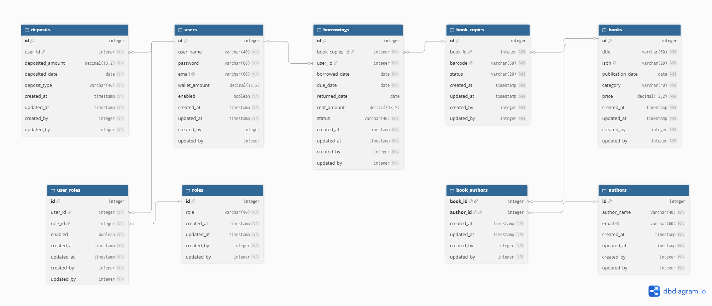

# Library Management System — V1

## 1. Introduction

The **Library Management System** is a Spring Boot application that manages the day-to-day operations of a library, including book management, borrowing, returning, user management, and wallet transactions.

The library generates income through non-refundable registration fees, wallet deposits, and book rental charges. The rental fee is calculated from the book's price and how long it is borrowed.

### Key Features

- User registration and role management.
- Book, physical copy, and author management.
- Book borrowing and returning.
- Automatic rental fee calculation based on borrowing duration.
- Wallet management and deposit history.
- Role-based authentication and authorization.
- DTO-based request and response models.
- Logging with Spring AOP.

### Version Scope

| Capability                                             |       V1 (this version)       |               V2 (planned)                |
| ------------------------------------------------------ | :---------------------------: | :---------------------------------------: |
| Spring Data JPA and Hibernate                          |              ✅               |                    ✅                     |
| Role-based authorization (4 roles)                     |              ✅               |                    ✅                     |
| Authentication                                         | Basic (username and password) |              JWT (stateless)              |
| Authorization rules                                    | Configured in Spring Security | Permission-based, managed in the database |
| DTOs for API requests and responses                    |              ✅               |                    ✅                     |
| Logging with Spring AOP                                |              ✅               |                    ✅                     |
| Transaction management, validation, exception handling |              ✅               |                    ✅                     |
| Unit and integration tests, Swagger / OpenAPI          |              ✅               |                    ✅                     |
| Token and session management                           |              ❌               |                    ✅                     |
| Payment gateway for wallet recharge                    |              ❌               |               Stretch goal                |

---

## 2. Rental Fee Calculation

Each book has a price, and the standard borrowing period is **14 days**. The rental fee is a percentage of the original book price.

### Rental Fee Structure

| Borrowing Duration |   Rental Fee |
| ------------------ | -----------: |
| 1–14 days          |          20% |
| 15–21 days         |          25% |
| 22–28 days         |          30% |
| 29–35 days         |          35% |
| 36–42 days         |          40% |
| More than 42 days  | 40% (capped) |

### Business Rules

1. Every borrowed book must be returned within 14 days.
2. A base rental fee of 20% of the book price is charged when the book is returned within the due date.
3. An additional 5% is charged for every subsequent overdue week.
4. The maximum rental fee is capped at 40% of the book price.
5. No additional percentage is charged beyond 40%.
6. If a book is not returned within 42 days, the Admin takes the necessary action to recover it.

### Calculation

```text
duration_days = (return_date - borrow_date) + 1      // the borrowing day counts as day 1
weeks         = ceil(duration_days / 7)
fee_percent   = min(20 + 5 * max(0, weeks - 2), 40)
rental_fee    = book_price * fee_percent / 100
```

The fee depends on the total elapsed borrowing duration, not on calendar month boundaries.

**Example:**

- Borrowing date: 1 May
- Due date: 14 May
- Returned on: 20 May, which is day 20, so 3 weeks and a 25% fee
- For a book priced at ₹500, the rental fee is ₹125

---

## 3. Types of Users

The library operates under the supervision of an Admin, who appoints Librarians to manage day-to-day operations.

Users who want to borrow books must register as library members. There are two types of members:

1. **Member:** Regular library members, including students.
2. **Faculty:** Faculty members whose membership category is verified during registration.

The system supports four roles: `MEMBER`, `FACULTY`, `LIBRARIAN`, and `ADMIN`.

---

## 4. Book Borrowing Limits

The maximum number of books a user can borrow at a time depends on their role.

| Role      | Maximum Borrowing Limit |
| --------- | ----------------------: |
| Member    |                       3 |
| Faculty   |                      10 |
| Librarian |                      10 |
| Admin     |                      10 |

The application validates the borrowing limit before creating a new borrowing record.

---

## 5. Wallet and Cash Flow Management

All financial transactions within the library are handled through an internal wallet system.

### Registration Charges

| Description                     |   Amount |
| ------------------------------- | -------: |
| Non-refundable Registration Fee |     ₹200 |
| Minimum Initial Wallet Deposit  |     ₹300 |
| **Total Initial Payment**       | **₹500** |

### Wallet Rules

1. Every new user pays a non-refundable registration fee of ₹200.
2. Every new user deposits a minimum of ₹300 into their wallet.
3. The registration fee and the initial wallet deposit are stored as separate transactions in the `DEPOSITS` table.
4. Users recharge their wallets through a Librarian.
5. The minimum amount for subsequent wallet recharges is ₹100.
6. All amounts credited to the wallet are non-refundable.
7. Rental fees are deducted directly from the user's wallet when a book return is processed.
8. A book return cannot be completed if the wallet balance is insufficient to cover the rental fee.

### Deposit Records Example

For a new user registration, two separate records are stored in `DEPOSITS`:

| Transaction Type | Amount |
| ---------------- | -----: |
| REGISTRATION_FEE |   ₹200 |
| WALLET_RECHARGE  |   ₹300 |

### Financial Tracking

- **DEPOSITS:** history of registration fees and wallet deposits received from users.
- **BORROWINGS:** borrowing and return history, including rental fees charged.
- **USERS:** current wallet balance of each user.

---

## 6. Roles and Responsibilities

| Role      | Responsibilities                                                                    |
| --------- | ----------------------------------------------------------------------------------- |
| Admin     | Manages users and oversees library operations.                                      |
| Librarian | Manages books, authors, physical book copies, returns, and wallet deposits.         |
| Member    | Borrows and returns books through the Librarian.                                    |
| Faculty   | Borrows and returns books through the Librarian, with an increased borrowing limit. |

Members and Faculty share the same basic library operations but have different borrowing limits.

---

## 7. Business Rules

### Admin

1. An Admin cannot delete a user until all of the user's dependencies are cleared. For example, a user cannot be deleted while they still have unreturned books.
2. At least one active Admin must always exist in the system.
3. The Admin is responsible for recovering books that remain unreturned beyond 42 days.

### Librarian

1. A Librarian cannot remove a book copy while it is currently borrowed and not yet returned.
2. A Librarian verifies the physical condition of a returned book and completes the return process in the application.
3. A Librarian handles wallet recharge requests and records the corresponding deposit transactions.
4. At least one active Librarian must always exist in the system.

### Members and Faculty

1. Only active and valid members can borrow books.
2. Users cannot exceed their borrowing limits.
3. Users must have sufficient wallet balance to pay the rental fee when returning a book.
4. If the wallet balance is insufficient, the user must recharge their wallet before the return can be completed.

### Borrowing Process

1. The member requests a book.
2. The Librarian verifies the member's eligibility and borrowing limit.
3. The Librarian checks the availability of physical book copies.
4. The Librarian issues an available book copy and creates the borrowing record.

### Return Process

1. The member physically hands the borrowed book to the Librarian.
2. The Librarian verifies the returned book and its physical condition.
3. The Librarian initiates the return through the application.
4. The application calculates the rental fee from the borrowing duration.
5. The rental fee is deducted from the user's wallet.
6. The borrowing record is updated.
7. The physical book copy becomes available for borrowing again.

---

## 8. Permissions and Access Control

| Operation         | MEMBER | FACULTY | LIBRARIAN | ADMIN |
| ----------------- | :----: | :-----: | :-------: | :---: |
| View Books        |   ❌   |   ❌    |    ✅     |  ✅   |
| Search Books      |   ✅   |   ✅    |    ✅     |  ✅   |
| View Book Details |   ❌   |   ❌    |    ✅     |  ✅   |
| View Book Copies  |   ✅   |   ✅    |    ✅     |  ✅   |
| Borrow Books      |   ❌   |   ❌    |    ✅     |  ✅   |
| Return Books      |   ❌   |   ❌    |    ✅     |  ✅   |
| Add Books         |   ❌   |   ❌    |    ✅     |  ✅   |
| Update Books      |   ❌   |   ❌    |    ✅     |  ✅   |
| Delete Books      |   ❌   |   ❌    |    ✅     |  ✅   |
| Recharge Wallet   |   ❌   |   ❌    |    ✅     |  ✅   |
| Manage Users      |   ❌   |   ❌    |    ❌     |  ✅   |

---

## 9. Application Architecture

The application follows a layered architecture to separate responsibilities.

### Technology and Design

1. **Spring Data JPA and Hibernate:** entity management and database operations.
2. **Spring Security:** authentication and role-based authorization.
3. **Layered Architecture:** Controller → Service → Repository → Entity.
4. **DTOs:** request and response models keep the API contract separate from persistence entities, so internal fields (such as password hashes) are never exposed.
5. **Transaction Management:** `@Transactional` for operations that touch multiple entities or tables within a single API request.
6. **Logging with Spring AOP:** an aspect handles cross-cutting logging (method entry and exit, execution time, and exceptions) without cluttering business code. Sensitive data such as passwords is never logged.
7. **Validation:** field-level and business-level validation.
8. **Exception Handling:** centralized handling with consistent error responses.
9. **Testing:** unit and integration tests.
10. **API Documentation:** Swagger / OpenAPI.

---

## 10. Database Design

The database uses relational entities and mapping tables to maintain relationships.

### Main Entities

| Entity       | Purpose                                                            |
| ------------ | ------------------------------------------------------------------ |
| USERS        | Stores all user information.                                       |
| ROLES        | Maintains the available roles in the application.                  |
| USER_ROLES   | Maps users to roles and maintains role assignments.                |
| BOOKS        | Stores book information.                                           |
| AUTHORS      | Stores author information.                                         |
| BOOK_AUTHORS | Maintains the many-to-many relationship between books and authors. |
| BOOK_COPIES  | Maintains individual physical copies of each book.                 |
| DEPOSITS     | Maintains user registration fee and wallet deposit history.        |
| BORROWINGS   | Maintains book borrowing and return history.                       |

### Design Decisions

1. **Users and Roles:** kept as separate entities, with `USER_ROLES` as the mapping entity between them.
2. **Books and Authors:** kept as separate entities, with `BOOK_AUTHORS` handling the many-to-many relationship.
3. **Book Copies:** users borrow a physical copy rather than a book title, so each copy has its own availability.
4. **Deposits:** a separate history table for registration fees and wallet recharges.
5. **User Types:** MEMBER, FACULTY, LIBRARIAN, and ADMIN share the same `USERS` table to avoid entity duplication.
6. **Borrowings:** stores borrowing and return history, including rental fee details.

### Entity Relationship Diagram



---

## 11. API Endpoints

Authentication in V1 uses username and password. Endpoints are grouped by access level.

### Authentication (Public)

| Method | Endpoint                     | Description                 |
| ------ | ---------------------------- | --------------------------- |
| POST   | `/api/auth/register-member`  | Register as a Member.       |
| POST   | `/api/auth/register-faculty` | Register as a Faculty user. |
| POST   | `/api/auth/login`            | Authenticate a user.        |

### Users, Roles, and User Roles (Admin)

| Method           | Endpoint               | Description                                        |
| ---------------- | ---------------------- | -------------------------------------------------- |
| GET              | `/api/users`           | Retrieve all users.                                |
| GET              | `/api/users/{id}`      | Retrieve a user by ID.                             |
| POST             | `/api/users`           | Create a user.                                     |
| PUT              | `/api/users/{id}`      | Update user information.                           |
| DELETE           | `/api/users/{id}`      | Delete a user.                                     |
| GET, POST        | `/api/roles`           | Retrieve all roles, or create a role.              |
| GET, PUT, DELETE | `/api/roles/{id}`      | Retrieve, update, or delete a role.                |
| GET, POST        | `/api/user_roles`      | Retrieve all user-role assignments, or create one. |
| GET, PUT, DELETE | `/api/user_roles/{id}` | Retrieve, update, or delete an assignment.         |

### Books, Authors, and Book Authors

| Method           | Endpoint                       | Access           | Description                                       |
| ---------------- | ------------------------------ | ---------------- | ------------------------------------------------- |
| GET              | `/api/books`                   | Librarian, Admin | Retrieve all books.                               |
| GET              | `/api/books/{id}`              | Librarian, Admin | Retrieve a book by ID.                            |
| POST             | `/api/books`                   | Librarian, Admin | Add a new book.                                   |
| PUT              | `/api/books/{id}`              | Librarian, Admin | Update book information.                          |
| DELETE           | `/api/books/{id}`              | Librarian, Admin | Delete a book.                                    |
| GET              | `/api/books/search?title=java` | All users        | Search books by title.                            |
| GET, POST        | `/api/authors`                 | Librarian, Admin | Retrieve all authors, or create an author.        |
| GET, PUT, DELETE | `/api/authors/{id}`            | Librarian, Admin | Retrieve, update, or delete an author.            |
| GET, POST        | `/api/book_authors`            | Librarian, Admin | Retrieve all book-author mappings, or create one. |
| GET, PUT, DELETE | `/api/book_authors/{id}`       | Librarian, Admin | Retrieve, update, or delete a mapping.            |

### Book Copies

| Method | Endpoint                | Access           | Description                   |
| ------ | ----------------------- | ---------------- | ----------------------------- |
| GET    | `/api/book_copies`      | All users        | Retrieve book copies.         |
| GET    | `/api/book_copies/{id}` | All users        | Retrieve a book copy by ID.   |
| POST   | `/api/book_copies`      | Librarian, Admin | Add a physical book copy.     |
| PUT    | `/api/book_copies/{id}` | Librarian, Admin | Update book copy information. |
| DELETE | `/api/book_copies/{id}` | Librarian, Admin | Delete a book copy.           |

### Borrowings (Librarian, Admin)

| Method | Endpoint                      | Description                  |
| ------ | ----------------------------- | ---------------------------- |
| POST   | `/api/borrowings`             | Create a borrowing record.   |
| GET    | `/api/borrowings/{id}`        | Retrieve a borrowing record. |
| POST   | `/api/borrowings/{id}/return` | Process a book return.       |
| GET    | `/api/borrowings/active`      | Retrieve active borrowings.  |
| GET    | `/api/borrowings/overdue`     | Retrieve overdue borrowings. |

### Deposits and Wallet (Librarian, Admin)

| Method | Endpoint        | Description                                       |
| ------ | --------------- | ------------------------------------------------- |
| POST   | `/api/deposits` | Record a wallet recharge or registration payment. |
| GET    | `/api/deposits` | Retrieve deposit history.                         |

### Current User (Authenticated Users)

| Method | Endpoint             | Description                                          |
| ------ | -------------------- | ---------------------------------------------------- |
| GET    | `/api/me`            | Retrieve the authenticated user's information.       |
| GET    | `/api/me/borrowings` | Retrieve the authenticated user's borrowing history. |

---

## 12. Setup

1. Install a JDK (see `pom.xml` for the required version) and MySQL.
2. Create a MySQL database for the application.
3. Set the database URL, username, and password in `application.properties`.
4. Run the application:

```bash
./mvnw spring-boot:run
```

5. Open the API documentation at `http://localhost:8080/swagger-ui/index.html` (default Swagger UI path).

To run the tests:

```bash
./mvnw test
```

---

## 13. Roadmap — Version 2

The following improvements are planned for the next version.

1. **JWT Authentication:** stateless authentication, replacing username and password credentials on every request.
2. **Dynamic Authorization:** V1 configures authorization rules in Spring Security. V2 introduces a permission-based database design so permissions can change without modifying application configuration.
3. **Session and Token Management:** token lifecycle handling, such as expiry and refresh.
4. **Payment Gateway (stretch goal):** online payment for registration and wallet recharges.

---

## 14. Project Goals

This project demonstrates practical implementation of:

- Java and Spring Boot.
- Spring Data JPA and Hibernate.
- Spring Security and authentication.
- Role-based authorization.
- REST API development with DTOs.
- Relational database design and entity relationships.
- Transaction management.
- Logging with Spring AOP.
- Input validation and exception handling.
- Unit and integration testing.
- API documentation using Swagger / OpenAPI.
